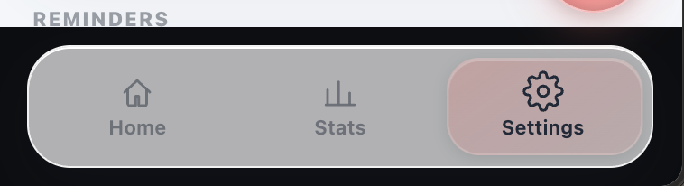

<div align="center">


# Classmark

**Know where your attendance stands — and what to do next.**

Classmark is a simple attendance tracker for students. Add your subjects, mark each class as present or absent, and instantly see whether you are above your target — including how many classes you can safely miss or need to attend.

It answers one question: *how many classes can I skip, or how many do I need to attend, to stay above my target?*

<br/>

[](https://github.com/chetanvhsk-wq/classmark-attendance/releases/latest)
[](https://github.com/chetanvhsk-wq/classmark-attendance/actions)
[](LICENSE)
[](https://classmark-attendance-nexus-9af5.vercel.app/)

[](https://classmark-attendance-nexus-9af5.vercel.app/)
[](https://classmark-attendance-nexus-9af5.vercel.app/)

[](problems%20and%20updates/updates.md)
[](problems%20and%20updates/problems.md)

</div>

## Start here

| Need | Go to |
|---|---|
| Try the app | [Live web app](https://classmark-attendance-nexus-9af5.vercel.app/) |
| Install Android | [Latest Stable Release](https://github.com/chetanvhsk-wq/classmark-attendance/releases/latest) |
| See what changed | [Updates](problems%20and%20updates/updates.md) |
| Understand the fixes | [Problems overcome](problems%20and%20updates/problems.md) |
| Run locally | [Run Locally](#run-locally) |

> **Private release candidate:** v1.0.3 is the latest published GitHub Release. The v1.0.7 candidate build passed on its review branch; main merge and release publication remain pending the required owner review and explicit release approval.

Classmark requires a signed-in account to open the workspace. Sign in with Google, email/password, or phone verification; your attendance workspace then syncs securely across your devices.

> **One account, every device:** Sign up once with Google or email/password and use that same account anywhere. Google-created accounts can also be given an email/password login from Firebase, so email/password remains a backup if Google sign-in is unavailable. Attendance, timetable, preferences, and other synced changes are reflected across every device signed in to the same account.

## How to use it

1. **Add your subjects** — enter each subject and your target attendance percentage (for example, 75%). You can also add attendance you recorded before using Classmark.
2. **Mark each class** — tap **Present** or **Absent** after class. You can choose another date when entering older attendance.
3. **Follow the guidance** — each subject shows your current percentage and the practical next step: how many classes you may skip or how many you need to attend to reach your target.

You can edit mistakes, review attendance by day, and open **Stats** for trends and a longer-term activity view. Use **Settings** to change the appearance, set reminders, import or export a backup, and manage your signed-in account.

### Sign in

The login screen supports Google, email/password, and phone verification. Create an account or sign in before using the attendance workspace. On a local web preview, run the app through `http://localhost:8000` and add `localhost` to Firebase Authentication’s authorized domains. Read the [Classmark Privacy Policy](www/privacy.html); signed-in users can delete their account and synced workspace from Settings.

### What the labels mean

| Label | Meaning |
|---|---|
| **Present** | You attended the class |
| **Absent** | You missed the class |
| **Target** | The minimum percentage you want to maintain |
| **On track** | Your current percentage is at or above your target |
| **Need to attend** | The number of future classes to attend in a row to reach your target |
| **Can skip** | The number of future classes you can miss while staying at or above your target |

> **Privacy note:** Attendance records and workspace settings sync only to the signed-in account. Timetable photos and wallpapers stay on-device even when sync is enabled.

## Why it is useful

Most attendance apps only show a percentage. Classmark turns that percentage into a clear decision: **am I safe to miss the next class, or do I need to attend?** It is designed for quick updates between classes, with detailed history available when you need to check your records.

## Origin

Classmark started as a fork of [Akshays-14/attendance-system-android](https://github.com/Akshays-14/attendance-system-android), a solid student attendance tracker built by **Akshay S** and **Bezaleel Paul**. Their original project laid the foundation.

[](https://github.com/Akshays-14) [](https://github.com/BezaleelPaul)

That said, what I built goes well beyond a surface-level fork. The original was a purely local, single-device app with no authentication layer. I rebuilt the data model, stripped third-party integrations that were visibly slowing both the web app and the Android build, and introduced a full Firebase backend that ties each user to a persistent account.

| Area | Original | Classmark |
|---|---|---|
| **Data storage** | `localStorage` only, one device | Firestore cloud sync — same data on every device you sign in to |
| **Authentication** | None | Firebase Auth — email/password, Google, and phone sign-in |
| **Performance** | Third-party widgets loaded at runtime, noticeable lag | Stripped CDN bloat; all libs (jsPDF, SheetJS, Firebase SDK) vendored locally at install time |
| **Hosting** | Static file server | Vercel with server-side Node functions — Gemini API key never touches the browser |
| **AI features** | — | Built-in Gemini integration for timetable photos, screenshots, and complex attendance parsing; local table parsing remains available |
| **Security** | No rules; all data public | Per-user Firestore security rules |

---

## Features

- Per-subject attendance with a configurable target percentage
- **Skip/attend math shown front and center** — always know exactly where you stand
- Swipe a subject card left to mark present, right to mark absent (buttons work too)
- Persistent **Add class** button available throughout the app, plus an inline Add subject row below Home subjects
- Four editable Home cards: rename or hide Overall, Subjects, Safe subjects, and the animated Glyph card
- Toggle the animated Home Glyph card on or off from Settings; tap it to customize its label and visibility
- Full Glyph editor with animated presets (streak, heart, star, smile, wave, checker), color choices, text/initials mode, and a custom 20×10 dot canvas
- Backfill past dates and edit or remove individual marks
- Stats: trend graph, 84-day heatmap, weekly recap with a shareable image, day log, subject reordering
- Reminders via Android Local Notifications or Web Notifications in the browser
- Native Android home-screen widget showing overall % and up to 4 subjects
- Export/import as JSON, CSV, PDF, and Excel — Android uses the system share sheet, web downloads normally
- Light/dark themes with multiple UI styles and accent colors
- Required Firebase Authentication — email/password, Google, or phone sign-in
- Owner-protected Firestore sync for attendance, course totals, timetable, and preferences

---

## Get the Android APK

1. Go to the **Actions** tab → open the latest green **Build Android APK** run
2. Download the **attendance-apk** artifact and unzip it
3. Copy `classmark.apk` to your phone and install it (allow "Install from unknown sources" when prompted)

The workflow runs on every push. You can also trigger it manually via **Run workflow**.

> **Note on signing:** The APK is signed with the debug keystore at `keystore/debug.keystore` (alias `androiddebugkey`, password `android`). Every CI build uses the same key, so new APKs install cleanly over old ones. Replace it with your own release keystore before publishing anywhere.

> **Local data heads-up:** The app stores data in the WebView's local storage. Export a JSON backup before uninstalling — uninstalling always wipes app data.

---

## Run Locally

**Requirements:** Node 20+, JDK 17, Android SDK (platform + build-tools), Python 3 + Pillow.

### Web preview

```bash
npm ci
npm run dev
```

Open `http://localhost:8000`. To enable Gemini features, create a `.env` at the root:

```env
GEMINI_API_KEY=your_gemini_api_key
```

Restart `npm run dev`. The local server proxies Gemini requests server-side — your key never reaches the browser. `.env` is gitignored.

> Add `localhost` to **Firebase Authentication → Settings → Authorized domains** before testing sign-in locally. Opening `www/index.html` via `file://` won't pass Firebase's authorized-domain check.

### Build the Android APK

```bash
npm ci
npx cap add android
python3 scripts/patch_android.py
npx cap sync android
cd android && ./gradlew assembleDebug
cp app/build/outputs/apk/debug/app-debug.apk app/build/outputs/apk/debug/classmark.apk
```

Output: `android/app/build/outputs/apk/debug/classmark.apk`

The Android Firebase config is intentionally not committed. For local Android builds, download `google-services.json` from Firebase and place it at the repository root. For GitHub Actions, add the complete file contents as a repository secret named `GOOGLE_SERVICES_JSON`; the workflow writes it only during the build.

### Deploy to Vercel

Point Vercel at the repository root. It runs `npm run vendor` and publishes `www/`. Gemini proxying runs through the serverless functions in `api/` — they read `GEMINI_API_KEY` from your Vercel Production/Preview environment.

Add your `*.vercel.app` hostname to **Firebase Authentication → Settings → Authorized domains**. Never put the Gemini key in a client-side or `NEXT_PUBLIC_` variable.

---

## Data & Privacy

Read the [Classmark Privacy Policy](www/privacy.html). It is also linked from the login gate and Settings. Signed-in users can delete their Firebase Authentication account and synced Firestore workspace from **Settings → Account & sync → Delete account and data**. Play Console privacy, Data safety, and other acknowledgement forms still require completion in the developer account before publishing.

- Attendance records, course totals, dated marks, timetable, and preferences sync to Firestore. Security rules restrict every account strictly to its own workspace.
- The Gemini API key is read server-side only — `.env` locally, Vercel environment in production. Never sent to the browser or written to Firestore.
- Timetable photos and wallpaper images stay on-device.
- The Firebase web config includes a public Firebase API key — that's not a secret. Don't put private Gemini keys anywhere in source.
- The Android Firebase config is kept out of Git. Restrict its API key to the `com.attendance.app` Android package and the signing certificate SHA-1 in Google Cloud Console.
- No analytics. Google Fonts falls back to system fonts offline. Export libraries and the Firebase SDK are pre-bundled into `www/vendor` at install time — never fetched from a CDN at runtime.
- Exported backups are user-initiated files — treat them as personal data.

---

## Known Limitations

- Debug build only — not Play Store-signed or Play Store-ready.
- Reminder delivery depends on Android battery management. On aggressive OEMs (e.g. OPPO/Realme), set battery usage to **Unrestricted** and allow auto-launch.
- Reminders are scheduled for a rolling 14-day window when the app runs. Reopen periodically to replenish it; a force-stop or reboot can affect pending deliveries.
- The launcher controls widget refresh cadence; the widget also refreshes when the app writes data.
- The UI lives in one large `www/index.html` — it works, but that's the main thing to refactor if you want to contribute substantially.

---

## Project Layout

```
www/                        Single-page web app (HTML/CSS/JS) + icons
  firebase-sync.js          Firebase Auth and Firestore sync client
  vendor/                   Generated at install time (jsPDF, SheetJS, Firebase SDK)
firebase.json               Firestore database configuration
firestore.rules             Per-user Firestore security rules
overlay/                    Native Android sources copied into the Capacitor project
scripts/patch_android.py    Injects widget, permissions, and icons after `cap add android`
scripts/vendor_libs.js      Bundles browser libraries into `www/vendor`
keystore/debug.keystore     Stable debug key (personal use only)
.github/workflows/          CI that builds the debug APK on every push
api/                        Vercel serverless functions (Gemini proxy)
```

---

## Screenshot



---

## Contributing

Issues and PRs are welcome. Keep changes focused, test on a real Android device when touching the native widget or notifications, and export a backup before testing import/export.

---

## License

MIT — see [LICENSE](LICENSE).

---

<div align="center">

### Project history

[Read the problems and stability log →](problems%20and%20updates/problems.md) · [View all updates →](problems%20and%20updates/updates.md)

</div>

---

<div align="center">

### More from Chetan

[Visit my portfolio →](https://portfolio-beta-gilt-29.vercel.app)

</div>
